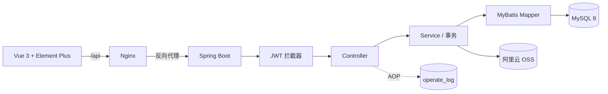
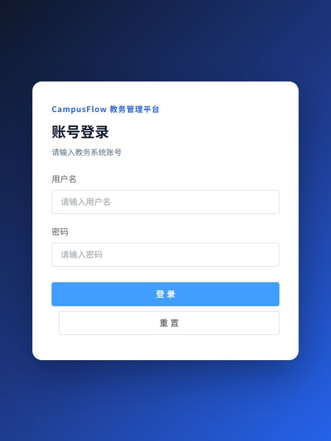
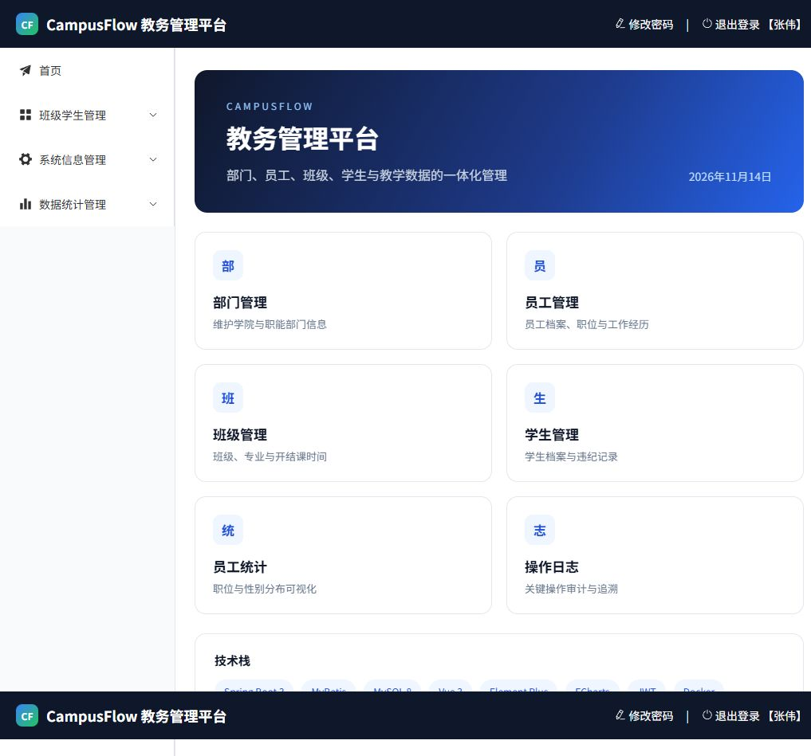

# CampusFlow · 教务管理平台

基于 **Spring Boot 3 + MyBatis + MySQL + Vue 3** 的前后端分离教务管理系统，覆盖部门、员工、班级、学生、数据报表与操作日志六大模块。

> 高校教务场景的前后端分离练习项目，包含 JWT 鉴权、参数校验、Swagger 接口文档、Docker 一键启动与 GitHub Actions 持续集成。

[](https://github.com/hecheng666/campus-flow/actions/workflows/ci.yml)


## 功能概览

- **登录鉴权**：JWT 无状态登录，拦截器统一校验，ThreadLocal 保存当前操作人
- **部门管理**：增删改查，名称唯一校验
- **员工管理**：分页 + 姓名/性别/入职日期条件查询，一对多工作经历维护
- **班级管理**：分页条件查询、辅导员关联、开课/结课状态计算；删除班级时自动迁移学生
- **学生管理**：分页条件查询、违纪扣分处理
- **数据报表**：员工职位分布、员工性别比例、学生学历分布、班级人数（ECharts）
- **操作日志**：自定义 `@Log` 注解 + AOP 环绕通知，记录操作人、方法、参数、返回值与耗时
- **文件上传**：阿里云 OSS 存储，按年月分目录 + UUID 文件名

## 技术栈

| 层次 | 技术 |
|---|---|
| 后端 | Java 17、Spring Boot 3.5、MyBatis 3、MySQL 8、JWT (jjwt)、AOP、Bean Validation |
| 前端 | Vue 3、Vite、Vue Router、Pinia、Element Plus、Axios、ECharts |
| 工程化 | Docker Compose、Nginx、GitHub Actions、springdoc-openapi |

## 架构



详细设计见 [docs/architecture.md](docs/architecture.md)。

## 快速开始

### 方式一：Docker Compose（推荐）

```bash
cp .env.example .env
docker compose up -d --build
```

启动后访问：

- 前端：<http://localhost>
- 后端：<http://localhost:8080>
- Swagger：<http://localhost:8080/swagger-ui.html>

首次启动会自动导入 `sql/schema.sql`。数据库数据保存在 `mysql-data` 卷中，重新导入需先执行 `docker compose down -v`。

### 方式二：本地运行

1. 创建数据库并导入数据：

   ```bash
   mysql -uroot -p < sql/schema.sql
   ```

2. 启动后端（默认连接 `localhost:3306/campusflow`，账号 `root/123456`）：

   ```bash
   cd backend
   mvn spring-boot:run
   ```

   可通过环境变量覆盖：`DB_URL`、`DB_USERNAME`、`DB_PASSWORD`、`JWT_SECRET`。

3. 启动前端：

   ```bash
   cd frontend
   npm install
   npm run dev
   ```

   访问 <http://localhost:5173>，Vite 已将 `/api` 代理到 `localhost:8080`。

### 演示账号

| 用户名 | 密码 |
|---|---|
| `zhangwei` | `123456` |
| `wangfang` | `123456` |

> 初始数据中的密码为明文演示数据，首次登录成功后会自动升级为 BCrypt 哈希。BCrypt 哈希长度为 60，数据库 `emp.password` 字段需为 `varchar(100)`；从旧版本升级时执行：
>
> ```sql
> ALTER TABLE emp MODIFY password varchar(100) DEFAULT '123456' COMMENT '密码, BCrypt 哈希';
> ```

## 接口文档

- 在线 Swagger UI：`http://localhost:8080/swagger-ui.html`
- 离线文档：[docs/api.md](docs/api.md)

## 项目结构

```
campus-flow/
├── backend/                 # Spring Boot 后端
│   ├── src/main/java/com/campusflow/
│   │   ├── anno/            # 自定义注解
│   │   ├── aop/             # 操作日志切面
│   │   ├── config/          # Web、JWT、Swagger、密码加密配置
│   │   ├── controller/      # REST 接口
│   │   ├── exception/       # 全局异常处理
│   │   ├── interceptor/     # JWT 拦截器
│   │   ├── mapper/          # MyBatis Mapper
│   │   ├── pojo/            # 实体与通用返回结构
│   │   ├── service/         # 业务接口与实现
│   │   └── utils/           # JWT、ThreadLocal、OSS 工具
│   └── src/main/resources/
├── frontend/                # Vue 3 前端
├── sql/schema.sql            # 数据库初始化脚本
├── docs/                    # 架构与接口文档
├── docker-compose.yml
└── .github/workflows/ci.yml
```

## 核心设计说明

- **鉴权**：登录成功后签发 HS256 JWT，前端在 `token` 请求头携带；拦截器校验签名与过期时间，并把员工 ID 写入 `ThreadLocal`，请求结束后清理，避免内存泄漏。
- **密码安全**：使用 BCrypt 存储密码，`Emp.password` 标记为 `WRITE_ONLY`，任何查询接口都不会把密码返回前端；历史明文密码在首次登录成功时自动升级。
- **分页一致性**：列表与总数查询共用同一段动态 SQL 条件，避免筛选后总数与列表不匹配。
- **事务**：员工与工作经历的新增/修改/删除、班级删除与学生迁移均在事务内完成。
- **操作审计**：`@Log` 注解标记需要审计的接口，AOP 环绕通知记录操作人、类名、方法名、参数、返回值与耗时。
- **配置安全**：数据库密码、JWT 密钥、OSS 配置全部通过环境变量注入，仓库中不包含任何真实凭证。

## 测试与 CI

```bash
cd backend && mvn test     # Service 与 JWT 单元测试
cd frontend && npm run build
```

GitHub Actions 在每次 push / PR 时自动执行后端测试与前端构建。

## 界面预览




## License

[MIT](LICENSE)
