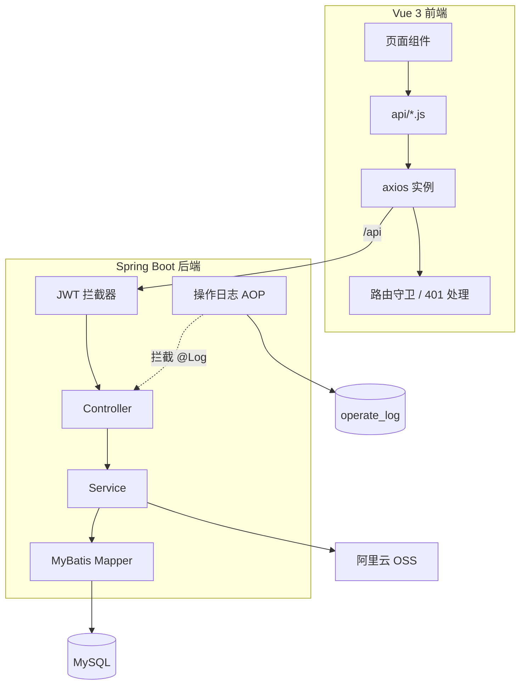
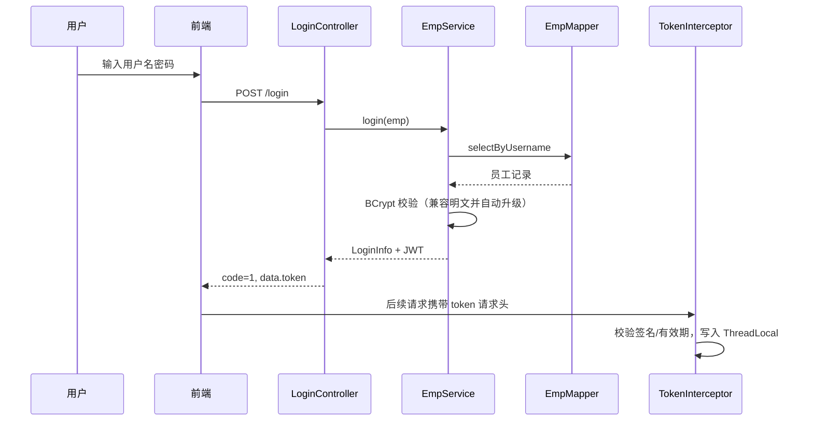
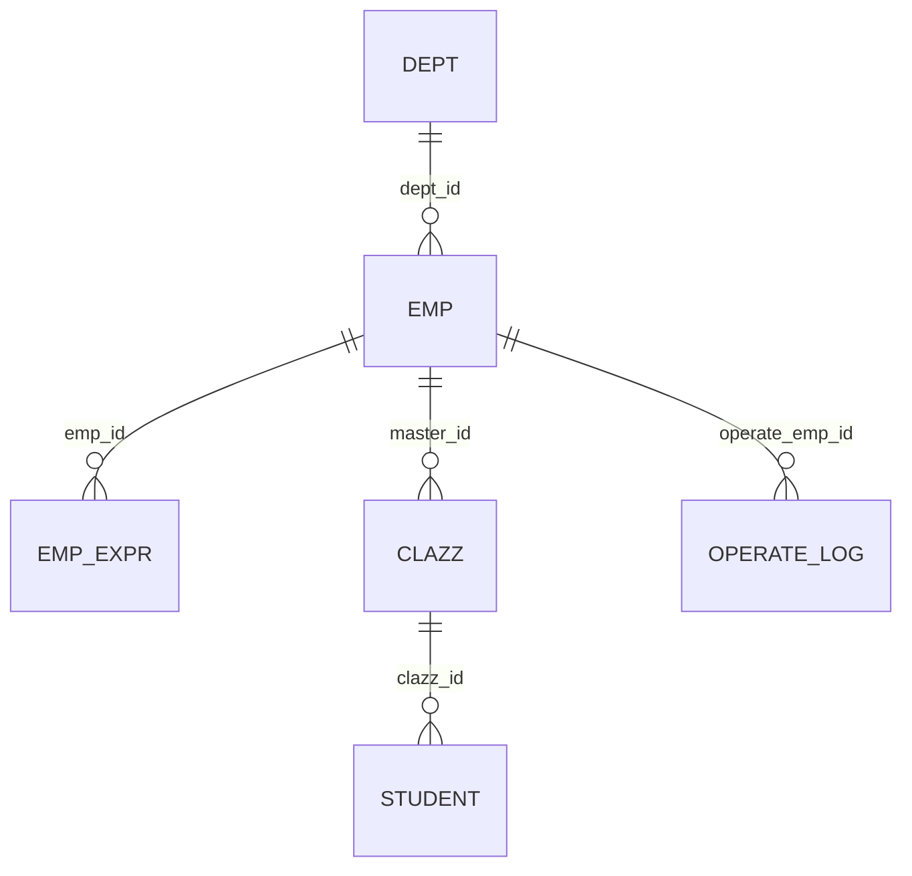

# 架构设计

## 1. 总体结构

前后端分离部署：Nginx 托管前端静态资源，并把 `/api` 反向代理到后端，避免生产环境跨域配置。

## 2. 模块划分

| 模块 | Controller | 主要能力 |
|---|---|---|
| 登录 | `LoginController` | 用户名密码登录、签发 JWT |
| 部门 | `DeptController` | 部门增删改查 |
| 员工 | `EmpController` | 条件分页、工作经历级联维护 |
| 班级 | `ClazzsController` | 条件分页、辅导员关联、状态计算 |
| 学生 | `StudentController` | 条件分页、违纪处理 |
| 报表 | `ReportController` | 职位/性别/学历/班级人数统计 |
| 日志 | `LogController` | 操作日志分页查询 |
| 上传 | `UploadController` | 图片上传至 OSS |

## 3. 关键流程

### 3.1 登录与鉴权

白名单通过 `WebConfig#excludePathPatterns` 精确配置，仅放行登录、错误页和 Swagger 文档。

### 3.2 操作日志

1. 在需要审计的接口上添加 `@Log`。
2. `OperationLogAspect` 使用 `@Around` 包裹目标方法。
3. 方法执行完成后，记录操作人（ThreadLocal）、类名、方法名、参数、返回值与耗时。
4. 日志写入 `operate_log` 表，前端日志页分页展示。

### 3.3 分页查询

统一采用 `start = (page - 1) * pageSize` + `limit #{start},#{pageSize}`：

- 列表 SQL 与总数 SQL 共用同一个 `<sql id="pageCondition">` 片段；
- 动态条件使用 `#{}` 参数绑定，避免 SQL 注入；
- 员工分页额外按员工 ID 查询工作经历，避免多表 join 产生笛卡尔积。

### 3.4 事务边界

| 场景 | 操作 |
|---|---|
| 新增员工 | 插入员工 → 批量插入工作经历 |
| 修改员工 | 更新员工 → 删除旧经历 → 插入新经历 |
| 删除员工 | 删除工作经历 → 删除员工 |
| 删除班级 | 学生迁移到“暂无对应班级” → 删除班级 |

均使用 `@Transactional(rollbackFor = Exception.class)`，保证异常时整体回滚。

## 4. 数据模型

- `emp`：员工账号、角色职位、部门、头像
- `emp_expr`：员工工作经历（一对多）
- `clazz`：班级、辅导员、开课/结课时间
- `student`：学生、班级、违纪记录
- `operate_log`：操作审计日志

## 5. 配置与部署

| 配置项 | 环境变量 | 说明 |
|---|---|---|
| 数据库地址 | `DB_URL` | 默认本机 `campusflow` 库 |
| 数据库账号 | `DB_USERNAME` / `DB_PASSWORD` | 默认 `root/123456` |
| JWT 密钥 | `JWT_SECRET` | 生产环境必须替换 |
| JWT 有效期 | `JWT_EXPIRE` | 默认 12 小时 |
| OSS | `OSS_ENDPOINT` / `OSS_BUCKET_NAME` / `OSS_REGION` | 不配置时仅上传功能不可用 |

`docker compose up -d --build` 会依次启动 MySQL、后端和前端；MySQL 首次启动时自动执行 `sql/schema.sql`。
